# VLM Medical Image Classification

- Source: [Figma Slides](https://www.figma.com/slides/cYF2Km81QCHiRwhM1RavcL/HPC?t=BCQrF6H02DCCmAjg-0)
- Extracted: 2026-09-22
- Pages: 14 (including 1 skipped slide)
- Content below preserves the visible slide text and speaker notes from the current Figma file.

---

## Slide 1 — VLM Medical Image Classification

<!-- Figma node: 1:42 -->

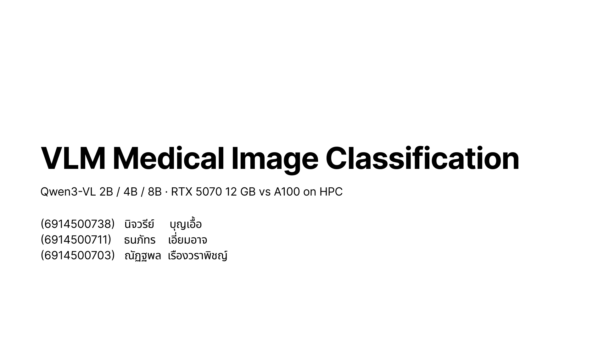

### VLM Medical Image Classification

Qwen3-VL 2B / 4B / 8B · RTX 5070 12 GB vs A100 on HPC

- (6914500738) นิจวรีย์ บุญเอื้อ
- (6914500711) ธนภัทร เอี่ยมอาจ
- (6914500703) ณัฏฐพล เรืองวราพิชญ์

### Speaker notes

คือเอา หลายโมเดล → ป้อนภาพเดียวกัน + prompt เดียวกัน → ดูว่าแต่ละโมเดลตอบออกมาเป็นอย่างไร → เปรียบเทียบผล

---

## Slide 2 — Problem

<!-- Figma node: 1:97 -->

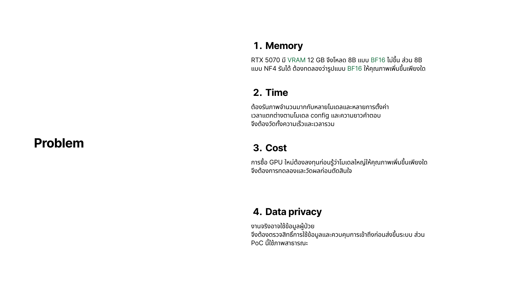

### Memory

RTX 5070 มี VRAM 12 GB จึงโหลด 8B แบบ BF16 ไม่ขึ้น ส่วน 8B แบบ NF4 รันได้ ต้องทดลองว่ารูปแบบ BF16 ให้คุณภาพเพิ่มขึ้นเพียงใด

### Time

ต้องรันภาพจำนวนมากกับหลายโมเดลและหลายการตั้งค่า เวลาแตกต่างตามโมเดล config และความยาวคำตอบ จึงต้องวัดทั้งความเร็วและเวลารวม

### Cost

การซื้อ GPU ใหม่ต้องลงทุนก่อนรู้ว่าโมเดลใหญ่ให้คุณภาพเพิ่มขึ้นเพียงใด จึงต้องการทดลองและวัดผลก่อนตัดสินใจ

### Data privacy

งานจริงอาจใช้ข้อมูลผู้ป่วย จึงต้องตรวจสิทธิ์การใช้ข้อมูลและควบคุมการเข้าถึงก่อนส่งขึ้นระบบ ส่วน PoC นี้ใช้ภาพสาธารณะ

### Speaker notes

Data Privacy ใช้อธิบายว่าทำไมไม่ใช้ cloud ภายนอก ไม่ใช่ว่าทำไมต้องย้ายออกจากเครื่องตัวเอง เพราะเครื่องตัวเอง private ที่สุด ถ้าโดนถามว่า "LANTA ใช้ร่วมกันหลายคน ปลอดภัยเหรอ" ให้ตอบว่าต้องขออนุญาตใช้ข้อมูลตามจริยธรรมการวิจัย และลบข้อมูลที่ระบุตัวผู้ป่วยก่อนนำขึ้น cluster ส่วน baseline ตอนนี้ใช้ภาพสาธารณะที่ไม่มีข้อมูลระบุตัวตน

---

## Slide 3 — Dataset: Chest X-ray Pneumonia

<!-- Figma node: 32:54 -->

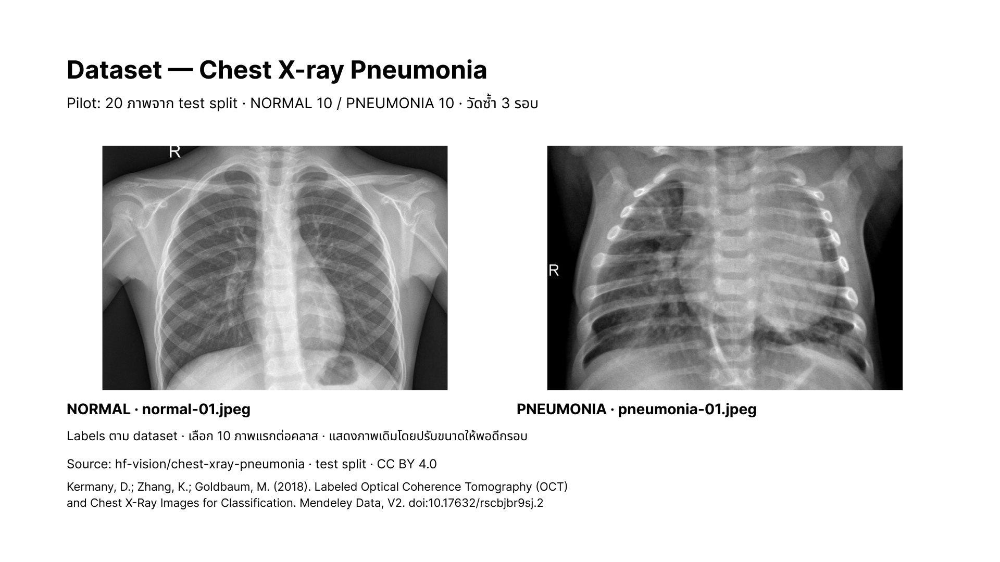

Pilot: 20 ภาพจาก test split · NORMAL 10 / PNEUMONIA 10 · วัดซ้ำ 3 รอบ

### Images

- Dataset NORMAL — `normal-01.jpeg`

  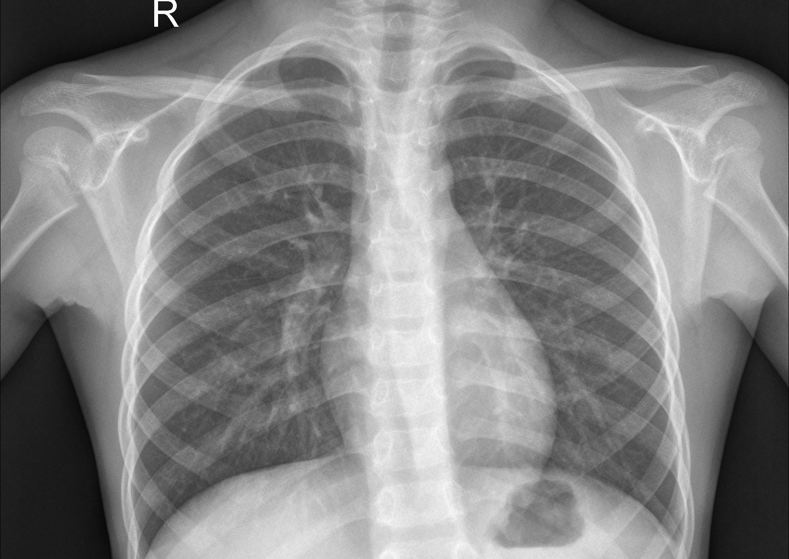

- Dataset PNEUMONIA — `pneumonia-01.jpeg`

  

Labels ตาม dataset · เลือก 10 ภาพแรกต่อคลาส · แสดงภาพเดิมโดยปรับขนาดให้พอดีกรอบ

### Source

- `hf-vision/chest-xray-pneumonia` · test split · CC BY 4.0
- Kermany, D.; Zhang, K.; Goldbaum, M. (2018). *Labeled Optical Coherence Tomography (OCT) and Chest X-Ray Images for Classification*. Mendeley Data, V2. doi:10.17632/rscbjbr9sj.2

### Speaker notes

**4,273**

---

## Slide 4 — Baseline

<!-- Figma node: 3:58 -->

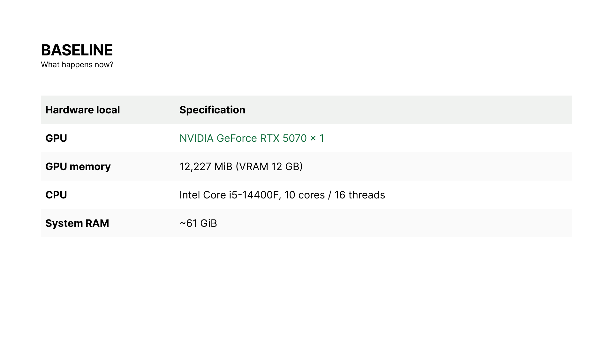

*What happens now?*

| Hardware local | Specification |
|---|---|
| GPU | NVIDIA GeForce RTX 5070 × 1 |
| GPU memory | 12,227 MiB (VRAM 12 GB) |
| CPU | Intel Core i5-14400F, 10 cores / 16 threads |
| System RAM | ~61 GiB |

---

## Slide 5 — Baseline: Local pilot results

<!-- Figma node: 59:54 -->

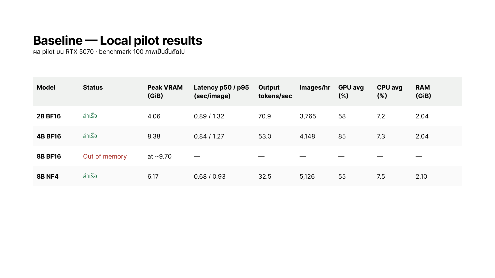

ผล pilot บน RTX 5070 · benchmark 100 ภาพเป็นขั้นถัดไป

| Model | Status | Peak VRAM (GiB) | Latency p50 / p95 (sec/image) | Output tokens/sec | images/hr | GPU avg (%) | CPU avg (%) | RAM (GiB) |
|---|---|---:|---:|---:|---:|---:|---:|---:|
| 2B BF16 | สำเร็จ | 4.06 | 0.89 / 1.32 | 70.9 | 3,765 | 58 | 7.2 | 2.04 |
| 4B BF16 | สำเร็จ | 8.38 | 0.84 / 1.27 | 53.0 | 4,148 | 85 | 7.3 | 2.04 |
| 8B BF16 | Out of memory | at ~9.70 | — | — | — | — | — | — |
| 8B NF4 | สำเร็จ | 6.17 | 0.68 / 0.93 | 32.5 | 5,126 | 55 | 7.5 | 2.10 |

---

## Slide 6 — Need

<!-- Figma node: 59:183 -->

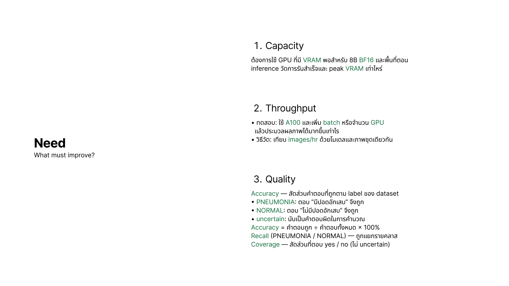

*What must improve?*

### Capacity

ต้องการใช้ GPU ที่มี VRAM พอสำหรับ 8B BF16 และพื้นที่ตอน inference วัดการรันสำเร็จและ peak VRAM เท่าไหร่

### Throughput

- ทดสอบ: ใช้ A100 และเพิ่ม batch หรือจำนวน GPU แล้วประมวลผลภาพได้มากขึ้นเท่าไร
- วิธีวัด: เทียบ images/hr ด้วยโมเดลและภาพชุดเดียวกัน

### Quality

- Accuracy — สัดส่วนคำตอบที่ถูกตาม label ของ dataset
  - PNEUMONIA: ตอบ “มีปอดอักเสบ” จึงถูก
  - NORMAL: ตอบ “ไม่มีปอดอักเสบ” จึงถูก
  - uncertain: นับเป็นคำตอบผิดในการคำนวณ
- Accuracy = คำตอบถูก ÷ คำตอบทั้งหมด × 100%
- Recall (PNEUMONIA / NORMAL) — ถูกแยกรายคลาส
- Coverage — สัดส่วนที่ตอบ yes / no (ไม่ uncertain)

### Speaker notes

**Throughput**

ในช่วงเวลาหนึง สามารถประมวลผลภาพได้กี่ภาพ โดยใช้โมเดลและชุดภาพเดียวกัน แล้วลองเพิ่ม Batch Size หรือจำนวน GPU เพื่อดูว่าระบบสามารถรองรับงานได้มากขึ้นแค่ไหน”

ส่วน Quality เราวัดด้วย 3 ตัวหลักค่ะ อย่างแรกคือ Accuracy ดูว่าตอบตรงกับ label จริงกี่เปอร์เซ็นต์ โดยกรณี uncertain จะนับเป็นคำตอบผิด อย่างที่สองคือ Recall ซึ่งดูแยกเป็นรายคลาส ทั้ง PNEUMONIA และ NORMAL และสุดท้ายคือ Coverage ดูว่าระบบสามารถให้คำตอบ yes หรือ no ได้กี่เปอร์เซ็นต์ โดยไม่นับกรณี uncertain ค่ะ

---

## Slide 7 — Platform fit

<!-- Figma node: 3:92 -->

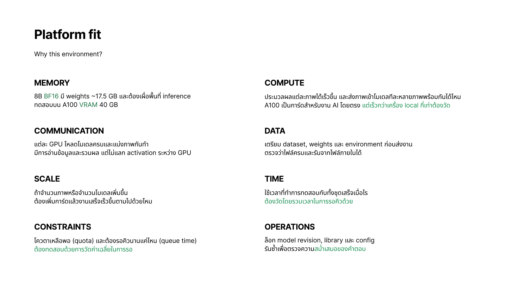

*Why this environment?*

### Memory

8B BF16 มี weights ~17.5 GB และต้องเผื่อพื้นที่ inference  
ทดสอบบน A100 VRAM 40 GB

### Compute

ประมวลผลแต่ละภาพได้เร็วขึ้น และส่งภาพเข้าโมเดลทีละหลายภาพพร้อมกันได้ไหม  
A100 เป็นการ์ดสำหรับงาน AI โดยตรง แต่เร็วกว่าเครื่อง local กี่เท่าต้องวัด

### Communication

แต่ละ GPU โหลดโมเดลครบและแบ่งภาพกันทำ  
มีการอ่านข้อมูลและรวมผล แต่ไม่แลก activation ระหว่าง GPU

### Data

เตรียม dataset, weights และ environment ก่อนส่งงาน  
ตรวจว่าไฟล์ครบและรันจากไฟล์ภายในได้

### Scale

ถ้าจำนวนภาพหรือจำนวนโมเดลเพิ่มขึ้น ต้องเพิ่มการ์ดแล้วงานเสร็จเร็วขึ้นตามไปด้วยไหม

### Time

ใช้เวลาที่ทำการทดสอบกับทั้งชุดเสร็จเมื่อไร  
ต้องวัดโดยรวมเวลาในการรอคิวด้วย

### Constraints

โควตาเหลือพอ (quota) และต้องรอคิวนานแค่ไหน (queue time)  
ต้องทดสอบด้วยการวัดค่าเฉลี่ยในการรอ

### Operations

ล็อก model revision, library และ config  
รันซ้ำเพื่อตรวจความสม่ำเสมอของคำตอบ

---

## Slide 8 — Experiments: A / B

<!-- Figma node: 7:110 -->

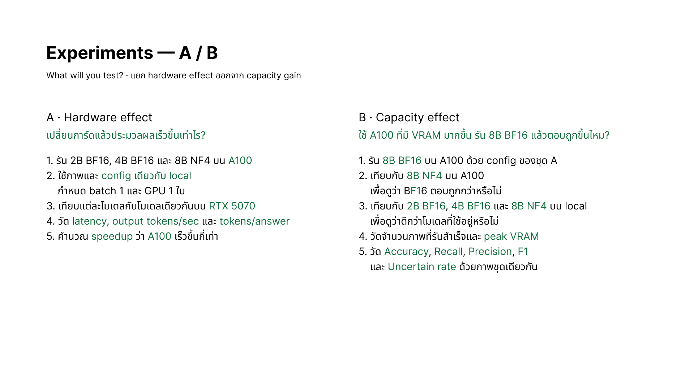

*What will you test? · แยก hardware effect ออกจาก capacity gain*

### A · Hardware effect

**เปลี่ยนการ์ดแล้วประมวลผลเร็วขึ้นเท่าไร?**

1. รัน 2B BF16, 4B BF16 และ 8B NF4 บน A100
2. ใช้ภาพและ config เดียวกับ local กำหนด batch 1 และ GPU 1 ใบ
3. เทียบแต่ละโมเดลกับโมเดลเดียวกันบน RTX 5070
4. วัด latency, output tokens/sec และ tokens/answer
5. คำนวณ speedup ว่า A100 เร็วขึ้นกี่เท่า

### B · Capacity effect

**ใช้ A100 ที่มี VRAM มากขึ้น รัน 8B BF16 แล้วตอบถูกขึ้นไหม?**

1. รัน 8B BF16 บน A100 ด้วย config ของชุด A
2. เทียบกับ 8B NF4 บน A100 เพื่อดูว่า BF16 ตอบถูกกว่าหรือไม่
3. เทียบกับ 2B BF16, 4B BF16 และ 8B NF4 บน local เพื่อดูว่าดีกว่าโมเดลที่ใช้อยู่หรือไม่
4. วัดจำนวนภาพที่รันสำเร็จและ peak VRAM
5. วัด Accuracy, Recall, Precision, F1 และ Uncertain rate ด้วยภาพชุดเดียวกัน

---

## Slide 9 — Experiments: C / Controls

<!-- Figma node: 59:196 -->

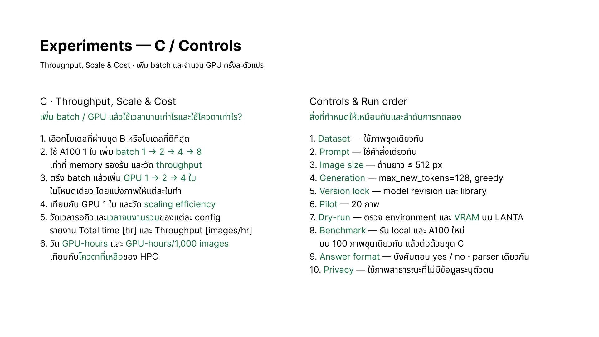

*Throughput, Scale & Cost · เพิ่ม batch และจำนวน GPU ครั้งละตัวแปร*

### C · Throughput, Scale & Cost

**เพิ่ม batch / GPU แล้วใช้เวลานานเท่าไรและใช้โควตาเท่าไร?**

1. เลือกโมเดลที่ผ่านชุด B หรือโมเดลที่ดีที่สุด
2. ใช้ A100 1 ใบ เพิ่ม batch 1 → 2 → 4 → 8 เท่าที่ memory รองรับ และวัด throughput
3. ตรึง batch แล้วเพิ่ม GPU 1 → 2 → 4 ใบ ในโหนดเดียว โดยแบ่งภาพให้แต่ละใบทำ
4. เทียบกับ GPU 1 ใบ และวัด scaling efficiency
5. วัดเวลารอคิวและเวลาจบงานรวมของแต่ละ config รายงาน Total time [hr] และ Throughput [images/hr]
6. วัด GPU-hours และ GPU-hours/1,000 images เทียบกับโควตาที่เหลือของ HPC

### Controls & Run order

**สิ่งที่กำหนดให้เหมือนกันและลำดับการทดลอง**

1. Dataset — ใช้ภาพชุดเดียวกัน
2. Prompt — ใช้คำสั่งเดียวกัน
3. Image size — ด้านยาว ≤ 512 px
4. Generation — `max_new_tokens=128`, greedy
5. Version lock — model revision และ library
6. Pilot — 20 ภาพ
7. Dry-run — ตรวจ environment และ VRAM บน LANTA
8. Benchmark — รัน local และ A100 ใหม่บน 100 ภาพชุดเดียวกัน แล้วต่อด้วยชุด C
9. Answer format — บังคับตอบ yes / no · parser เดียวกัน
10. Privacy — ใช้ภาพสาธารณะที่ไม่มีข้อมูลระบุตัวตน

---

## Slide 10 — Evidence: A / Hardware

<!-- Figma node: 7:118 -->

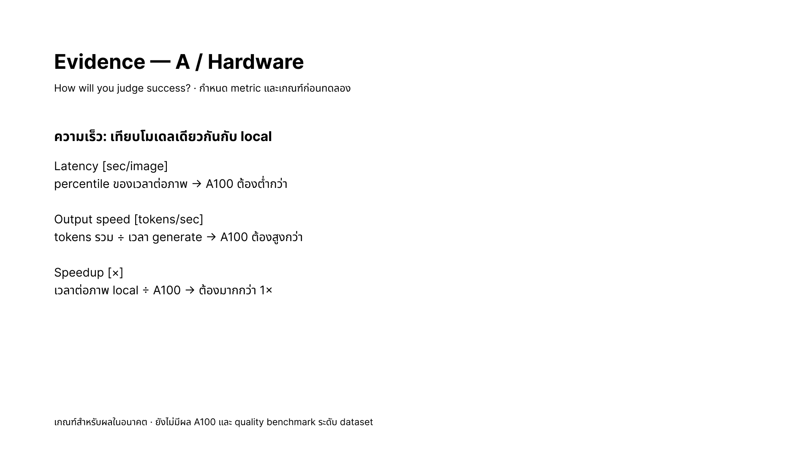

*How will you judge success? · กำหนด metric และเกณฑ์ก่อนทดลอง*

### ความเร็ว: เทียบโมเดลเดียวกันกับ local

#### Latency [sec/image]

percentile ของเวลาต่อภาพ → A100 ต้องต่ำกว่า

#### Output speed [tokens/sec]

tokens รวม ÷ เวลา generate → A100 ต้องสูงกว่า

#### Speedup [×]

เวลาต่อภาพ local ÷ A100 → ต้องมากกว่า 1×

> เกณฑ์สำหรับผลในอนาคต · ยังไม่มีผล A100 และ quality benchmark ระดับ dataset

---

## Slide 11 — Evidence: B / Capacity & Quality

<!-- Figma node: 59:214 -->

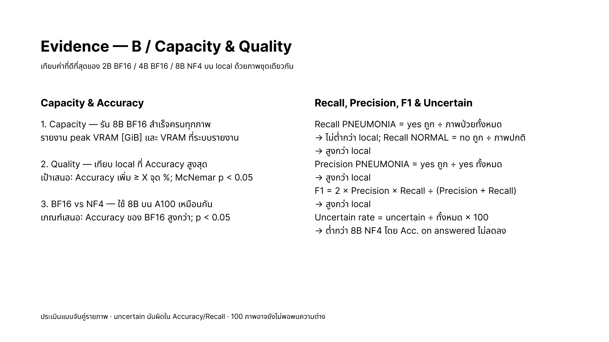

เทียบค่าที่ดีที่สุดของ 2B BF16 / 4B BF16 / 8B NF4 บน local ด้วยภาพชุดเดียวกัน

### Capacity & Accuracy

1. Capacity — รัน 8B BF16 สำเร็จครบทุกภาพ รายงาน peak VRAM [GiB] และ VRAM ที่ระบบรายงาน
2. Quality — เทียบ local ที่ Accuracy สูงสุด  
   เป้าเสนอ: Accuracy เพิ่ม ≥ X จุด %; McNemar p < 0.05
3. BF16 vs NF4 — ใช้ 8B บน A100 เหมือนกัน  
   เกณฑ์เสนอ: Accuracy ของ BF16 สูงกว่า; p < 0.05

### Recall, Precision, F1 & Uncertain

- Recall PNEUMONIA = yes ถูก ÷ ภาพป่วยทั้งหมด → ไม่ต่ำกว่า local
- Recall NORMAL = no ถูก ÷ ภาพปกติ → สูงกว่า local
- Precision PNEUMONIA = yes ถูก ÷ yes ทั้งหมด → สูงกว่า local
- F1 = 2 × Precision × Recall ÷ (Precision + Recall) → สูงกว่า local
- Uncertain rate = uncertain ÷ ทั้งหมด × 100 → ต่ำกว่า 8B NF4 โดย Acc. on answered ไม่ลดลง

> ประเมินแบบจับคู่รายภาพ · uncertain นับผิดใน Accuracy/Recall · 100 ภาพอาจยังไม่พอพบความต่าง

---

## Slide 12 — Evidence: C / Time, Scale & Cost

<!-- Figma node: 26:91 -->

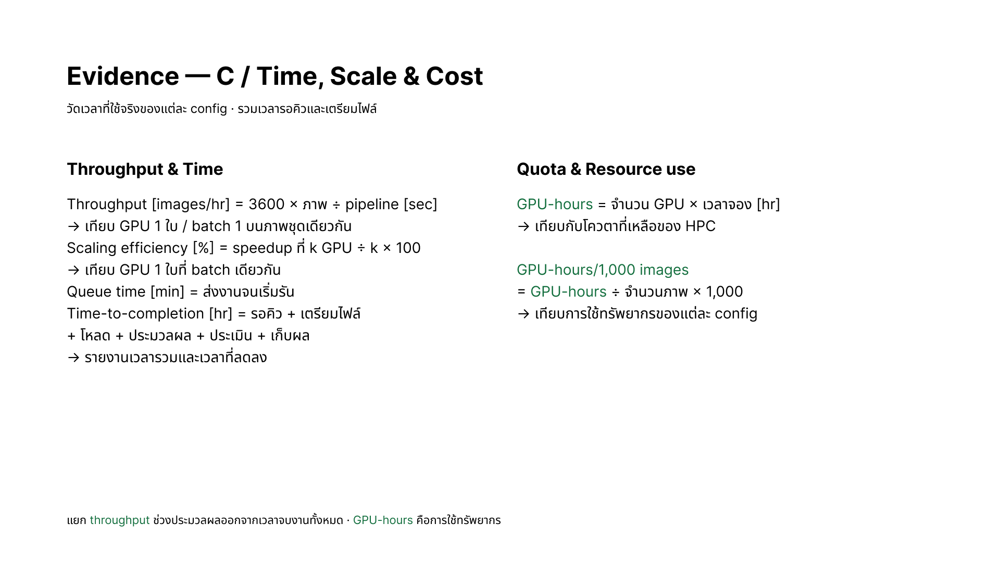

วัดเวลาที่ใช้จริงของแต่ละ config · รวมเวลารอคิวและเตรียมไฟล์

### Throughput & Time

- Throughput [images/hr] = 3600 × ภาพ ÷ pipeline [sec]  
  → เทียบ GPU 1 ใบ / batch 1 บนภาพชุดเดียวกัน
- Scaling efficiency [%] = speedup ที่ k GPU ÷ k × 100  
  → เทียบ GPU 1 ใบที่ batch เดียวกัน
- Queue time [min] = ส่งงานจนเริ่มรัน
- Time-to-completion [hr] = รอคิว + เตรียมไฟล์ + โหลด + ประมวลผล + ประเมิน + เก็บผล  
  → รายงานเวลารวมและเวลาที่ลดลง

### Quota & Resource use

- GPU-hours = จำนวน GPU × เวลาจอง [hr]  
  → เทียบกับโควตาที่เหลือของ HPC
- GPU-hours/1,000 images = GPU-hours ÷ จำนวนภาพ × 1,000  
  → เทียบการใช้ทรัพยากรของแต่ละ config

> แยก throughput ช่วงประมวลผลออกจากเวลาจบงานทั้งหมด · GPU-hours คือการใช้ทรัพยากร

---

## Slide 13 — Evidence: When to change the conclusion

<!-- Figma node: 26:101; skipped in presentation -->

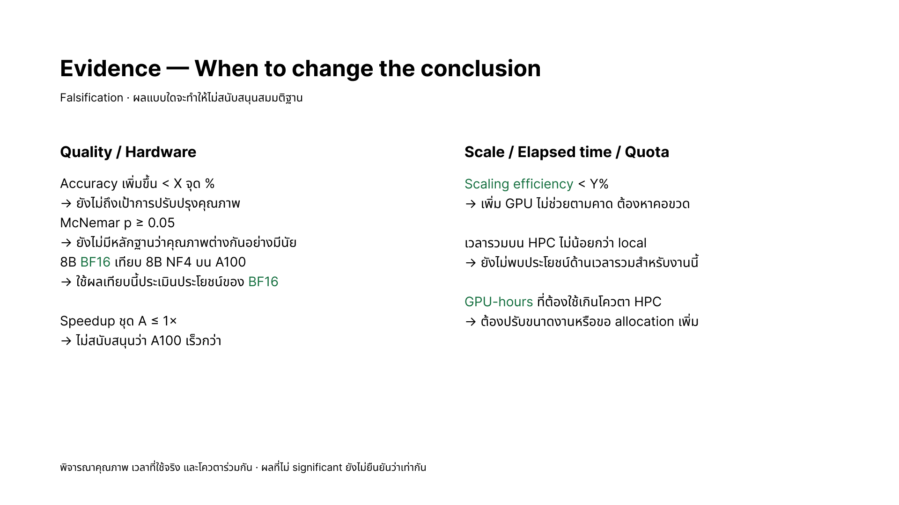

> **Status:** This slide is currently marked as skipped in Figma Slides.

*Falsification · ผลแบบใดจะทำให้ไม่สนับสนุนสมมติฐาน*

### Quality / Hardware

- Accuracy เพิ่มขึ้น < X จุด %  
  → ยังไม่ถึงเป้าการปรับปรุงคุณภาพ
- McNemar p ≥ 0.05  
  → ยังไม่มีหลักฐานว่าคุณภาพต่างกันอย่างมีนัย
- 8B BF16 เทียบ 8B NF4 บน A100  
  → ใช้ผลเทียบนี้ประเมินประโยชน์ของ BF16
- Speedup ชุด A ≤ 1×  
  → ไม่สนับสนุนว่า A100 เร็วกว่า

### Scale / Elapsed time / Quota

- Scaling efficiency < Y%  
  → เพิ่ม GPU ไม่ช่วยตามคาด ต้องหาคอขวด
- เวลารวมบน HPC ไม่น้อยกว่า local  
  → ยังไม่พบประโยชน์ด้านเวลารวมสำหรับงานนี้
- GPU-hours ที่ต้องใช้เกินโควตา HPC  
  → ต้องปรับขนาดงานหรือขอ allocation เพิ่ม

> พิจารณาคุณภาพ เวลาที่ใช้จริง และโควตาร่วมกัน · ผลที่ไม่ significant ยังไม่ยืนยันว่าเท่ากัน

---

## Slide 14 — Thank you

<!-- Figma node: 7:132; slide name in Figma: 13 -->

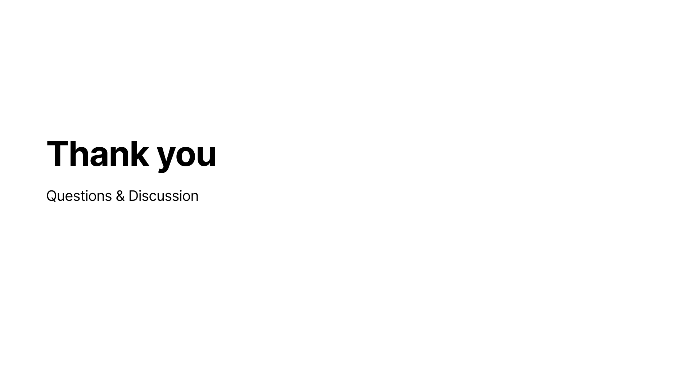

# Thank you

## Questions & Discussion
